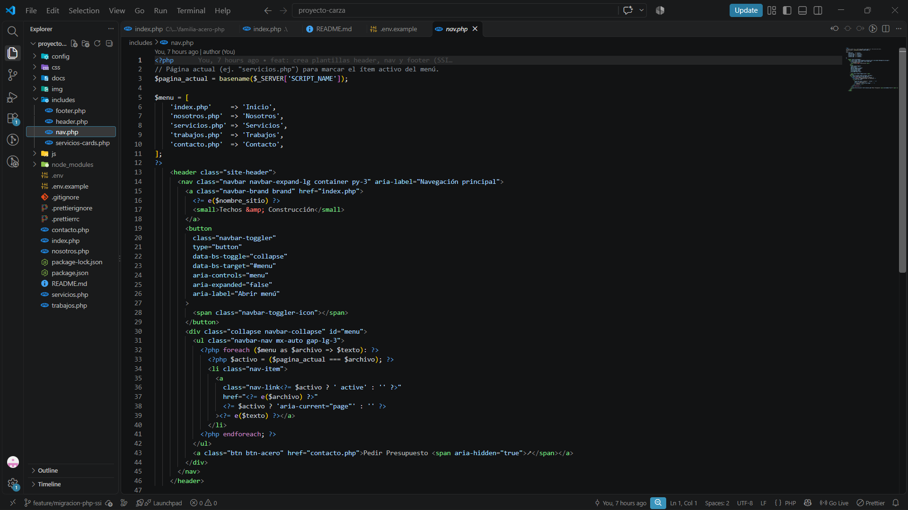
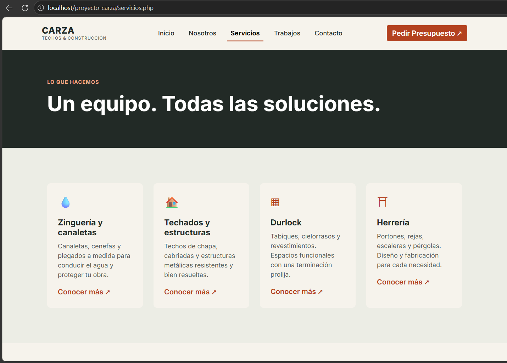
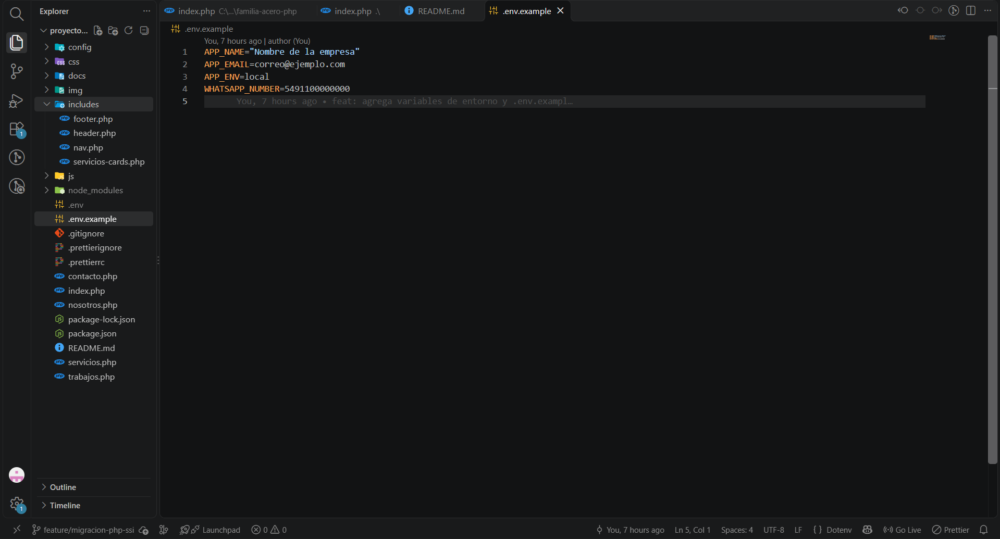
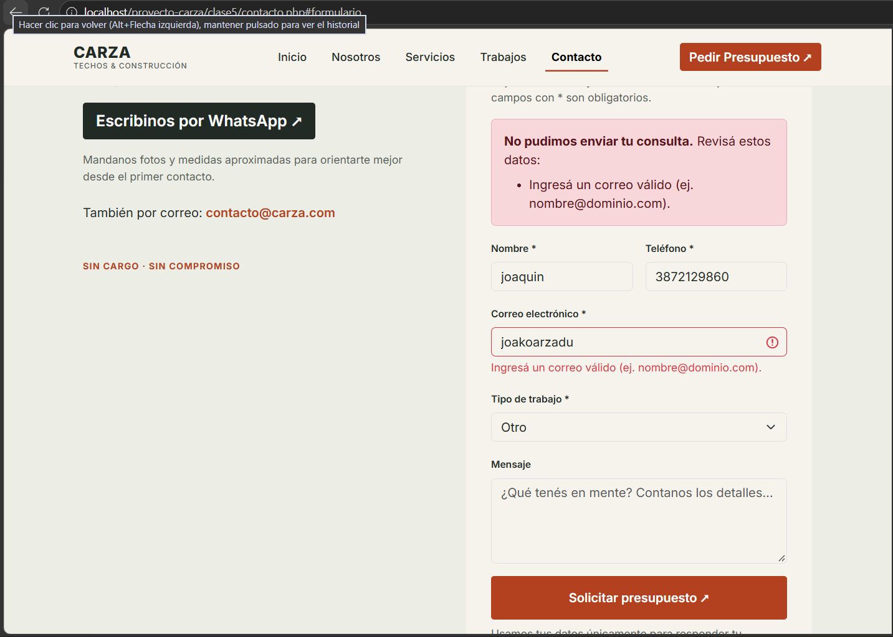
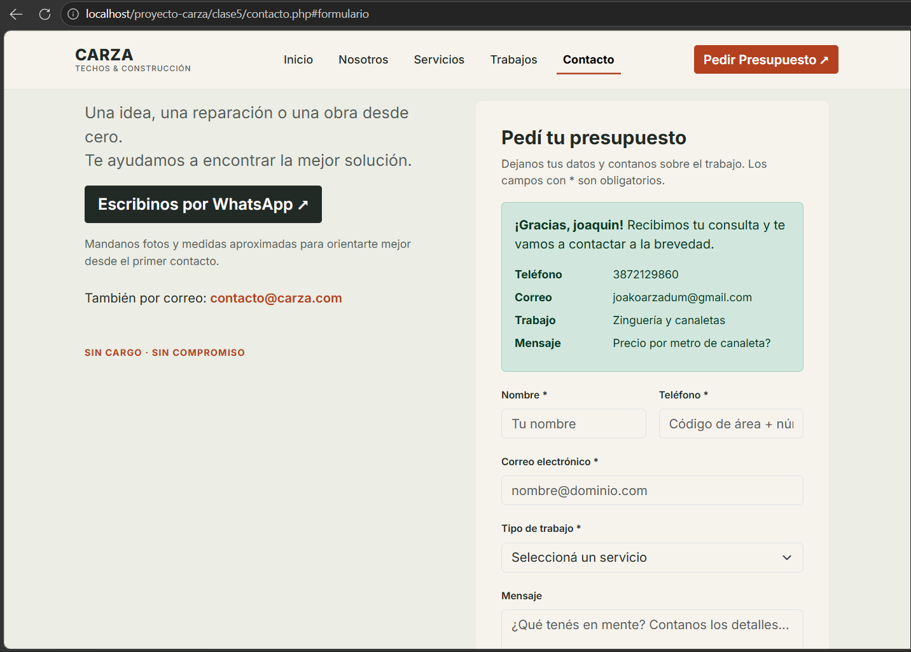
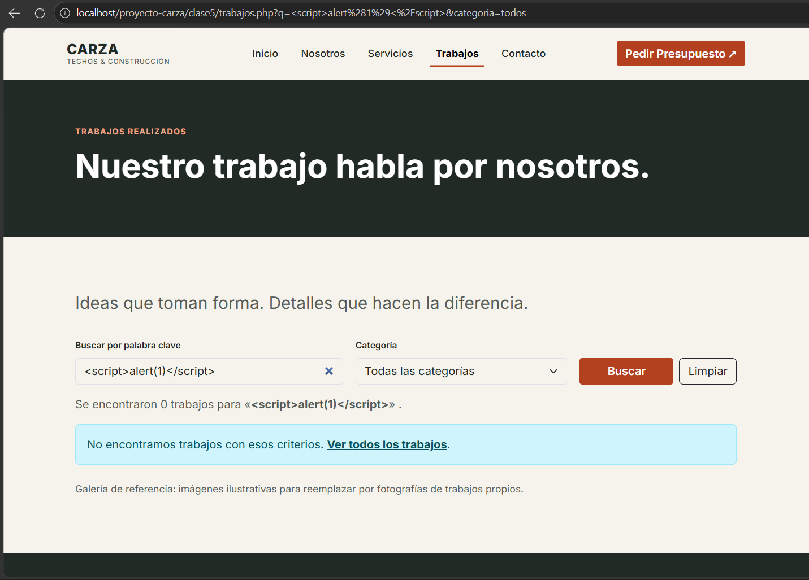
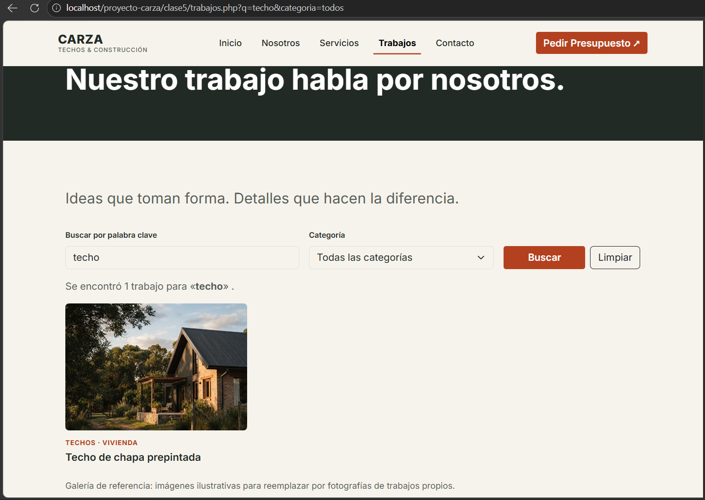
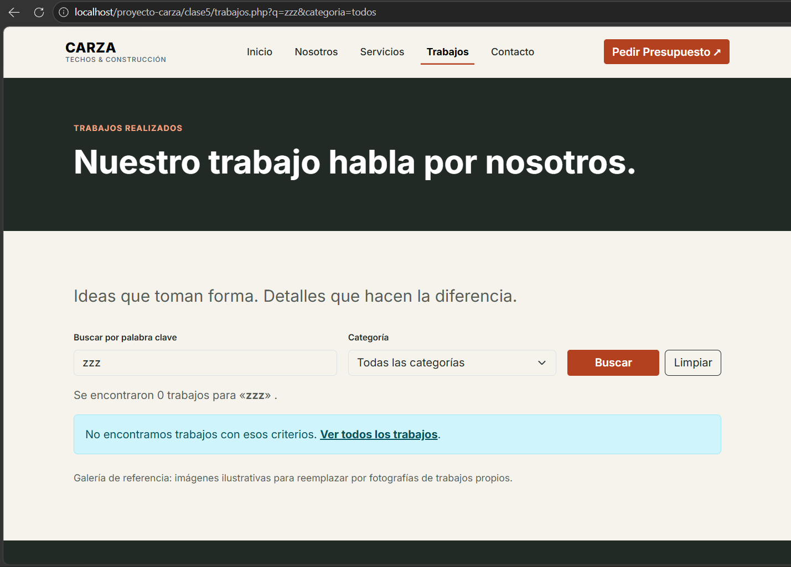

# CARZA – Techos & Construcción

Sitio web de un emprendimiento familiar de **zinguería, techados, Durlock (construcción en seco) y herrería**.

**Etapas del proyecto**

- **Hito 1:** maqueta estática (HTML5 + Bootstrap), diseñada previamente en Figma.
- **Unidad 4 (este trabajo):** migración a **PHP 8**, modularización con **Server Side Includes** (`header.php`, `nav.php`, `footer.php` y un partial de tarjetas), título dinámico por página, ítem activo del menú y configuración mediante variables de entorno (`.env`).

## Prototipo de Figma

https://www.figma.com/design/GXLKNmkhT7ZV941HH8dCkk/Sin-t%C3%ADtulo?node-id=0-1&t=fMAWgxlCZfZc2zTP-0

## Tecnologías utilizadas

- HTML5 semántico
- CSS3 + Bootstrap 5.3 (CDN)
- JavaScript (vanilla)
- PHP 8.x
- XAMPP / Laragon (servidor local)
- Git y GitHub (ramas + Pull Requests)
- Prettier y Lighthouse (ver [`docs/auditoria-lighthouse.md`](docs/auditoria-lighthouse.md))

## Estructura del proyecto

```
carza/
├── config/
│   └── env.php            # carga del .env y helpers
├── includes/
│   ├── header.php         # <head>, metadatos, CSS, título dinámico
│   ├── nav.php            # menú con ítem activo
│   ├── footer.php         # pie de página y scripts JS
│   └── servicios-cards.php
├── css/styles.css
├── js/main.js
├── img/
├── index.php
├── nosotros.php
├── servicios.php
├── trabajos.php
├── contacto.php
├── .env.example
└── .gitignore             # incluye .env
```

## Variables de entorno

| Variable          | Descripción                      |
| ----------------- | -------------------------------- |
| `APP_NAME`        | Nombre de la empresa/aplicación  |
| `APP_EMAIL`       | Email de contacto                |
| `APP_ENV`         | Entorno de ejecución (`local`)   |
| `WHATSAPP_NUMBER` | Número de WhatsApp (con código)  |

El archivo `.env` **no se versiona** (está en `.gitignore`); la plantilla es `.env.example`.

## Evidencia de funcionamiento

### Servidor local ejecutándose


### Estructura modular (SSI)




### Navegación dinámica (título de pestaña e ítem activo)



### Variables de entorno


## Flujo de trabajo con Git

- `main`: versión estable.
- `feature/maquetacion`: maqueta estática (Hito 1).
- `feature/migracion-php-ssi`: migración a PHP + SSI + `.env`, integrada por Pull Request.

## Clase 5 – Procesamiento de formularios y seguridad web

Todo el desarrollo de esta entrega está en la carpeta [`clase5/`](clase5/). Es la evolución del sitio de CARZA (PHP + SSI) con procesamiento de formularios del lado del servidor y prevención de XSS.

### Formularios creados

| Formulario | Método | Dónde | Qué hace |
| --- | --- | --- | --- |
| Pedí tu presupuesto | **POST** | `clase5/contacto.php` | Recibe nombre, teléfono, correo, tipo de trabajo y mensaje. Valida en el servidor, muestra errores por campo, conserva lo escrito si hay errores y muestra un resumen al enviar con éxito. |
| Buscador de trabajos | **GET** | `clase5/trabajos.php` | Filtra la galería por palabra clave (`?q=`) y categoría (`?categoria=`). Los criterios quedan en la URL. |

### Seguridad aplicada (XSS – OWASP Top 10)

- Los datos de `$_POST` y `$_GET` se leen con `filter_input()` dentro de `obtener_post()` / `obtener_get()` (`clase5/includes/funciones.php`), que además descartan arrays, eliminan caracteres de control y aplican `trim()`.
- Toda variable se imprime con `e()`, un envoltorio de `htmlspecialchars(..., ENT_QUOTES, 'UTF-8')`, tanto en mensajes como en los atributos `value` y en el `<textarea>`.
- Validación en servidor: campos obligatorios (`=== ''`), formato de correo con `filter_var(FILTER_VALIDATE_EMAIL)`, teléfono y nombre con expresiones regulares, longitudes máximas con `mb_strlen()` y lista blanca para el tipo de trabajo y la categoría.
- Mensajes claros de éxito y error, y persistencia de los campos completados cuando hay errores.

### Capturas de pantalla

**POST – errores de validación y datos conservados**


**POST – envío exitoso**


**POST – intento de XSS escapado**


**GET – resultados filtrados**


**GET – sin resultados / intento de XSS en la búsqueda**


### Cómo probarlo

1. Copiá `clase5/.env.example` como `clase5/.env`.
2. Iniciá Apache en XAMPP/Laragon y abrí `http://localhost/proyecto-carza/clase5/`.


## Autor

Arzadum, Joaquin Jairo – Programación Web, Unidad 4.
