# CARZA – Techos & Construcción

Sitio web de un emprendimiento familiar de **zinguería, techados, Durlock (construcción en seco) y herrería**.

**Etapas del proyecto**

- **Hito 1:** maqueta estática (HTML5 + Bootstrap), diseñada previamente en Figma.
- **Unidad 4 (este trabajo):** migración a **PHP 8**, modularización con **Server Side Includes** (`header.php`, `nav.php`, `footer.php` y un partial de tarjetas), título dinámico por página, ítem activo del menú y configuración mediante variables de entorno (`.env`).

## Prototipo de Figma

https://www.figma.com/design/GXLKNmkhT7ZV941HH8dCkk/Sin-t%C3%ADtulo?node-id=0-1&t=fMAWgxlCZfZc2zTP-0

## Tecnologías utilizadas

- HTML5 semántico
- CSS3 + Bootstrap 5.3 (CDN)
- JavaScript (vanilla)
- PHP 8.x
- XAMPP / Laragon (servidor local)
- Git y GitHub (ramas + Pull Requests)
- Prettier y Lighthouse (ver [`docs/auditoria-lighthouse.md`](docs/auditoria-lighthouse.md))

## Estructura del proyecto

```
carza/
├── config/
│   └── env.php            # carga del .env y helpers
├── includes/
│   ├── header.php         # <head>, metadatos, CSS, título dinámico
│   ├── nav.php            # menú con ítem activo
│   ├── footer.php         # pie de página y scripts JS
│   └── servicios-cards.php
├── css/styles.css
├── js/main.js
├── img/
├── index.php
├── nosotros.php
├── servicios.php
├── trabajos.php
├── contacto.php
├── .env.example
└── .gitignore             # incluye .env
```

## Variables de entorno

| Variable          | Descripción                      |
| ----------------- | -------------------------------- |
| `APP_NAME`        | Nombre de la empresa/aplicación  |
| `APP_EMAIL`       | Email de contacto                |
| `APP_ENV`         | Entorno de ejecución (`local`)   |
| `WHATSAPP_NUMBER` | Número de WhatsApp (con código)  |

El archivo `.env` **no se versiona** (está en `.gitignore`); la plantilla es `.env.example`.

## Evidencia de funcionamiento

### Servidor local ejecutándose


### Estructura modular (SSI)
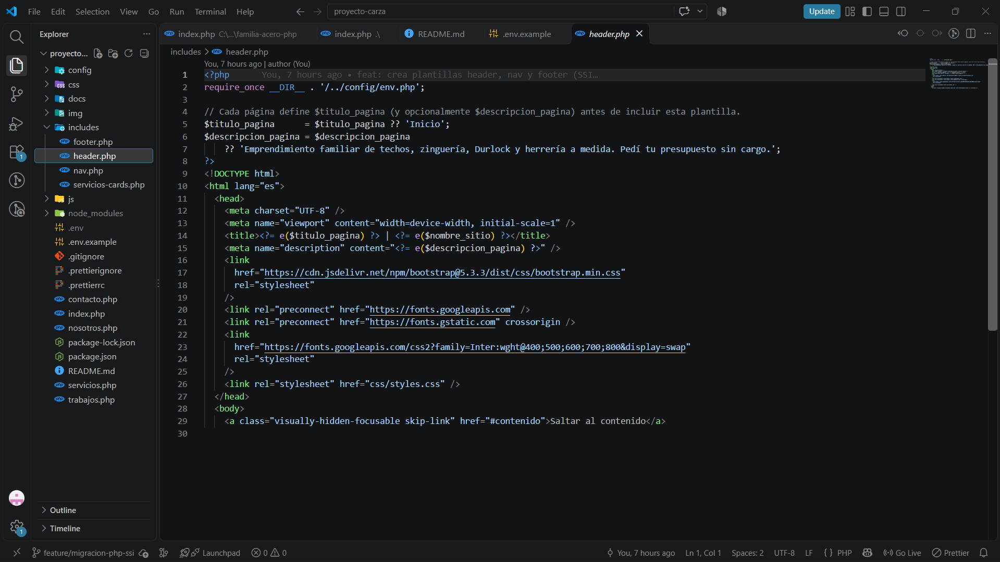

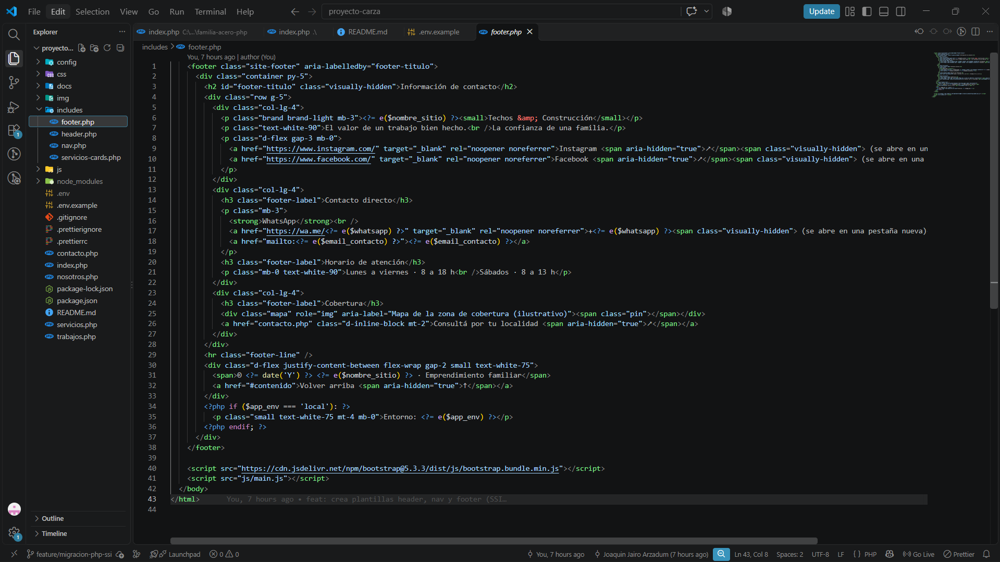

### Navegación dinámica (título de pestaña e ítem activo)


### Variables de entorno


## Flujo de trabajo con Git

- `main`: versión estable.
- `feature/maquetacion`: maqueta estática (Hito 1).
- `feature/migracion-php-ssi`: migración a PHP + SSI + `.env`, integrada por Pull Request.

## Clase 5 – Procesamiento de formularios y seguridad web

Todo el desarrollo de esta entrega está en la carpeta [`clase5/`](clase5/). Es la evolución del sitio de CARZA (PHP + SSI) con procesamiento de formularios del lado del servidor y prevención de XSS.

### Formularios creados

| Formulario | Método | Dónde | Qué hace |
| --- | --- | --- | --- |
| Pedí tu presupuesto | **POST** | `clase5/contacto.php` | Recibe nombre, teléfono, correo, tipo de trabajo y mensaje. Valida en el servidor, muestra errores por campo, conserva lo escrito si hay errores y muestra un resumen al enviar con éxito. |
| Buscador de trabajos | **GET** | `clase5/trabajos.php` | Filtra la galería por palabra clave (`?q=`) y categoría (`?categoria=`). Los criterios quedan en la URL. |

### Seguridad aplicada (XSS – OWASP Top 10)

- Los datos de `$_POST` y `$_GET` se leen con `filter_input()` dentro de `obtener_post()` / `obtener_get()` (`clase5/includes/funciones.php`), que además descartan arrays, eliminan caracteres de control y aplican `trim()`.
- Toda variable se imprime con `e()`, un envoltorio de `htmlspecialchars(..., ENT_QUOTES, 'UTF-8')`, tanto en mensajes como en los atributos `value` y en el `<textarea>`.
- Validación en servidor: campos obligatorios (`=== ''`), formato de correo con `filter_var(FILTER_VALIDATE_EMAIL)`, teléfono y nombre con expresiones regulares, longitudes máximas con `mb_strlen()` y lista blanca para el tipo de trabajo y la categoría.
- Mensajes claros de éxito y error, y persistencia de los campos completados cuando hay errores.

### Capturas de pantalla

**POST – errores de validación y datos conservados**


**POST – envío exitoso**


**POST – intento de XSS escapado**


**GET – resultados filtrados**


**GET – sin resultados / intento de XSS en la búsqueda**


### Cómo probarlo

1. Copiá `clase5/.env.example` como `clase5/.env`.
2. Iniciá Apache en XAMPP/Laragon y abrí `http://localhost/proyecto-carza/clase5/`.

## TP N° 6 – Diseño y creación del esquema relacional en MySQL


- [`NORMALIZACION.md`](tp6/NORMALIZACION.md): normalización (1FN, 2FN, 3FN) y diagrama entidad-relación.
- [`schema.sql`](tp6/schema.sql): script DDL de la base `carza_db` (9 tablas, claves foráneas, auditoría e índices).
- [`consultas.sql`](tp6/consultas.sql): pruebas CRUD (INSERT, SELECT con WHERE/ORDER BY/INNER JOIN, UPDATE, DELETE).

Para ejecutarlos, abrí phpMyAdmin (`http://localhost/phpmyadmin`) y corré primero `schema.sql` y después `consultas.sql`.

## TP N° 7 – Persistencia y conexión PHP-MySQL segura (PDO)

Todo el desarrollo está en la carpeta [`tp7/`](tp7/). Es el sitio de CARZA (PHP + SSI) conectado a la base `carza_db` diseñada en el TP6.

### Qué se implementó

| Módulo | Archivo | Operación |
| --- | --- | --- |
| Formulario de presupuesto (público) | `tp7/contacto.php` | **Create**: guarda la consulta en `consultas` y su rubro en `consulta_categoria` (con transacción) |
| Galería de trabajos (público) | `tp7/trabajos.php` | **Read**: lee `trabajos` con `INNER JOIN` y filtra por palabra clave y categoría (GET) |
| Panel: trabajos | `tp7/admin/index.php`, `crear.php`, `editar.php`, `eliminar.php` | **CRUD completo** sobre la tabla `trabajos` |
| Panel: consultas | `tp7/admin/consultas.php` | **Read / Update / Delete**: listar, cambiar estado y eliminar consultas |

### Seguridad

- Conexión PDO en `tp7/config/conexion.php` con `try-catch (PDOException)`, `ERRMODE_EXCEPTION` y `EMULATE_PREPARES = false`. Los datos de conexión salen del `.env` (no se sube al repositorio).
- **Consultas preparadas** con marcadores nombrados en todas las operaciones (`INSERT`, `SELECT`, `UPDATE`, `DELETE`).
- **XSS:** toda variable impresa en las vistas pasa por `e()` (`htmlspecialchars`).
- Validación en servidor de todos los formularios y listas permitidas para categorías, localidades y estados.
- Las bajas se hacen por **POST con token CSRF**, no por enlaces GET.

### Capturas de pantalla

**Formulario de contacto guardando una consulta**
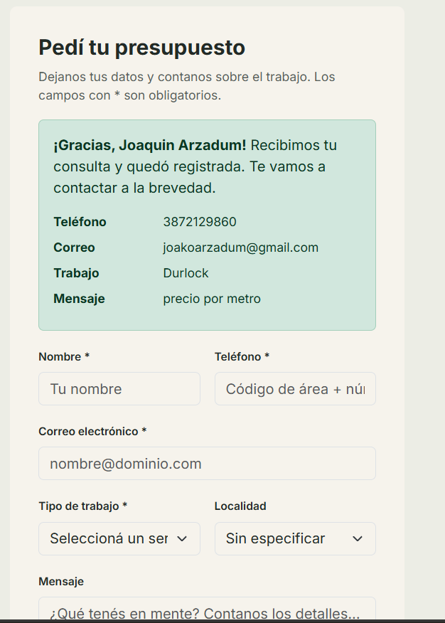

**Consulta registrada en phpMyAdmin**
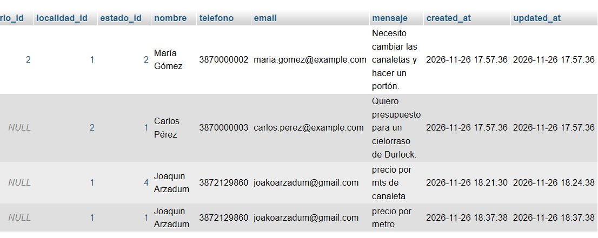

**Panel: listado de trabajos**
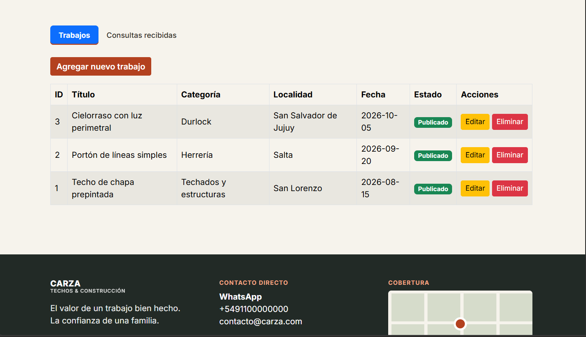

**Panel: alta de un trabajo**
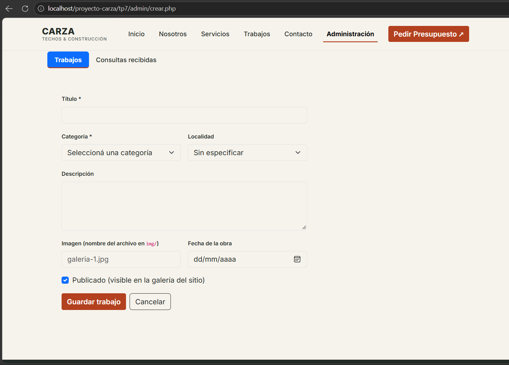

**Panel: edición**
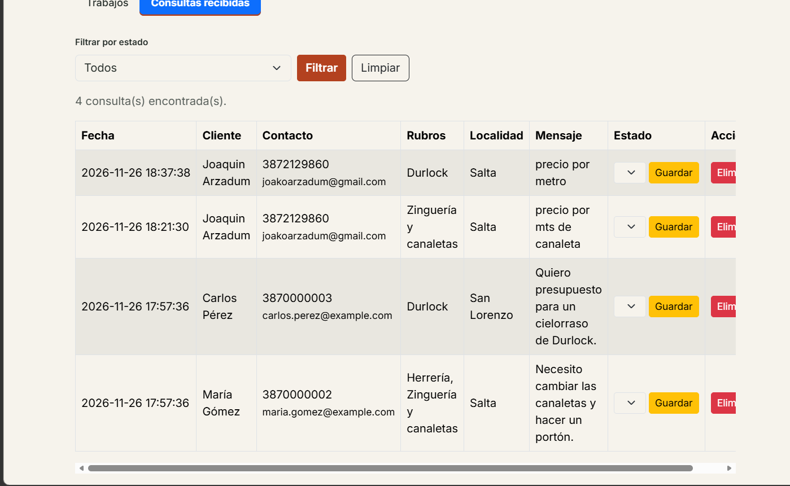

**Panel: eliminación (confirmación)**
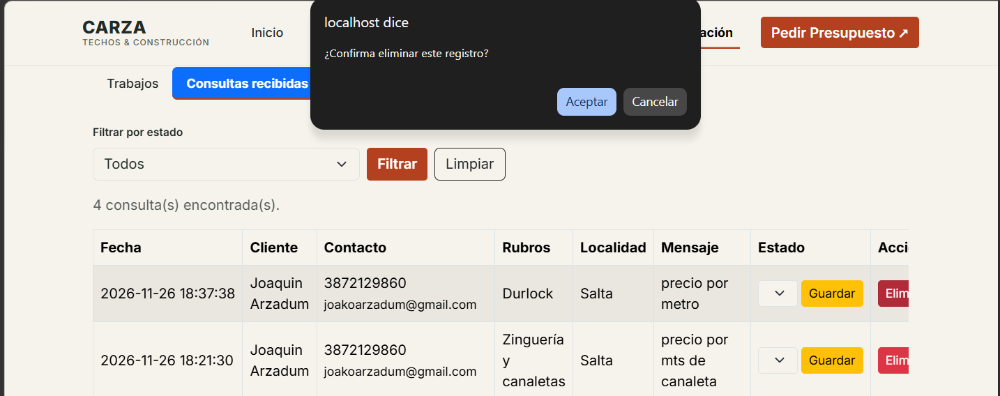

**Panel: consultas recibidas**
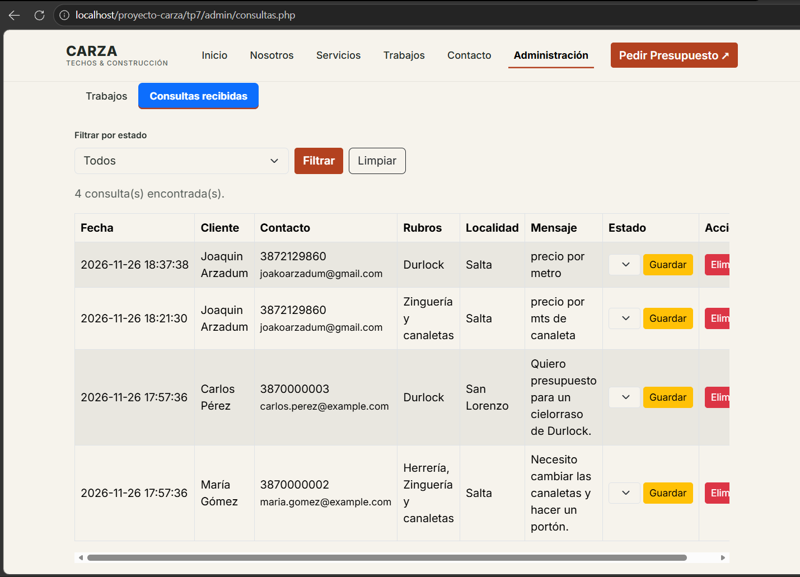

## TP N° 8 – Manejo de estado, sesiones y autenticación

Todo el desarrollo está en la carpeta [`tp8/`](tp8/): el sitio de CARZA con registro, inicio de sesión, cierre de sesión, protección de rutas y control de acceso por roles. La migración de la base está en [`tp8/sql/migracion_tp8.sql`](tp8/sql/migracion_tp8.sql).

### Módulos

| Archivo | Función |
| --- | --- |
| `tp8/registro.php` | Alta de usuarios: sanitización, validación, verificación de correo único y `password_hash($password, PASSWORD_BCRYPT)` |
| `tp8/login.php` | `password_verify()`, `session_regenerate_id(true)` y carga de `$_SESSION['usuario_id']`, `['usuario_nombre']` y `['rol']` |
| `tp8/includes/auth_guard.php` | Guardián de rutas: sin sesión redirige a `login.php?error=acceso_denegado`; con `$rol_requerido` restringe por rol |
| `tp8/logout.php` | Vacía `$_SESSION`, elimina la cookie de sesión y ejecuta `session_destroy()` |
| `tp8/perfil.php` | Página protegida (cualquier usuario logueado): datos de la cuenta y estado de sus consultas |
| `tp8/admin/*` | Panel protegido: **solo el rol `admin`** |

### Base de datos

La tabla `usuarios` del TP6 cumple la estructura pedida, con el diseño normalizado:

| Pedido en el TP8 | En `carza_db` |
| --- | --- |
| `id` | `usuarios.id` (PK, auto-increment) |
| `nombre` | `usuarios.nombre` (+ `apellido`) |
| `email` (único) | `usuarios.email` (UNIQUE) |
| `password` (VARCHAR 255) | `usuarios.password_hash` (VARCHAR 255, hash bcrypt) |
| `rol` ('admin' / 'usuario') | `usuarios.rol_id` → `roles.nombre` ('admin' / 'usuario'), normalizado en 3FN |
| `created_at` | `usuarios.created_at` |

### Seguridad aplicada

- Contraseñas con **bcrypt** (`password_hash` / `password_verify`); nunca se guardan ni se muestran en texto plano. Se limita a 72 caracteres, el máximo que usa bcrypt.
- **Session fixation:** `session_regenerate_id(true)` al iniciar sesión.
- **Cookie de sesión segura:** `HttpOnly`, `SameSite=Lax`, `Secure` bajo HTTPS, modo estricto y solo por cookies.
- Mensaje de error genérico en el login (no revela si el correo existe) y tiempo de respuesta similar.
- **XSS:** toda variable impresa pasa por `htmlspecialchars`.
- **SQL Injection:** consultas preparadas con PDO en todas las operaciones.
- **CSRF:** token en los formularios de registro, login, logout y del panel.
- **Control de acceso por rol:** el panel `/admin/` exige `$rol_requerido = 'admin'`.

### Capturas de pantalla

**Registro con errores de validación**
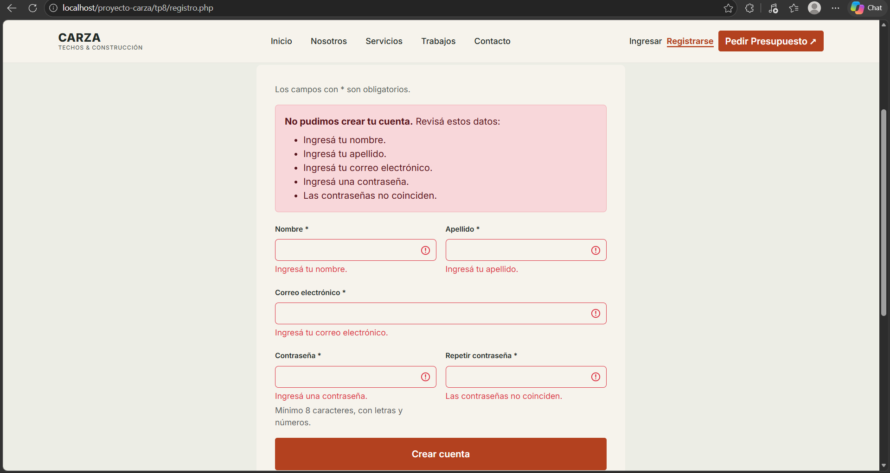

**Usuario guardado con el hash en phpMyAdmin**
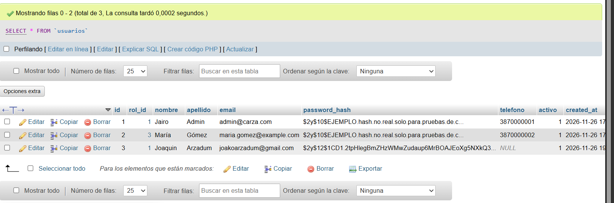

**Login con credenciales incorrectas**
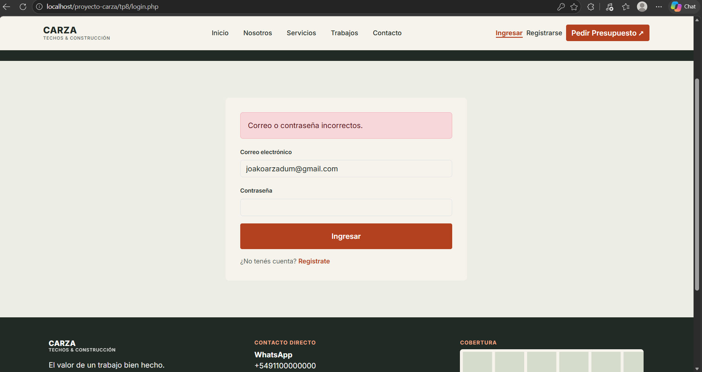

**Login correcto: página "Mi cuenta"**
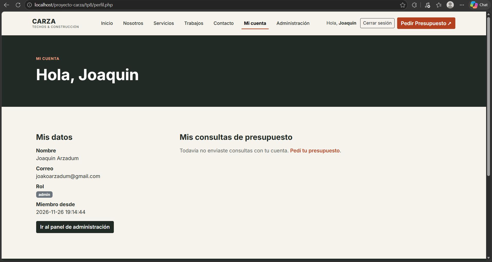

**Acceso a una página protegida sin sesión (redirige al login)**
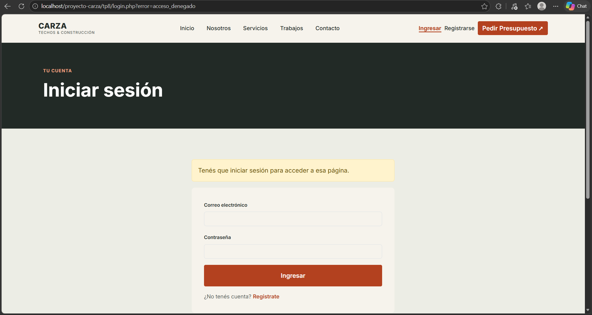

**Usuario sin rol admin intentando entrar al panel**
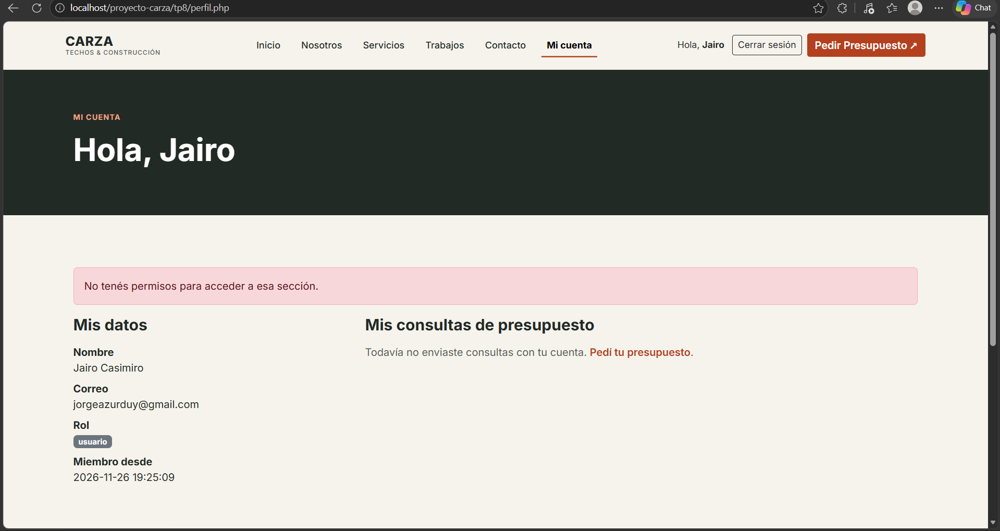

**Administrador dentro del panel**
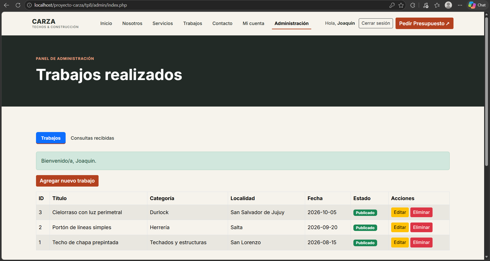

**Cierre de sesión**
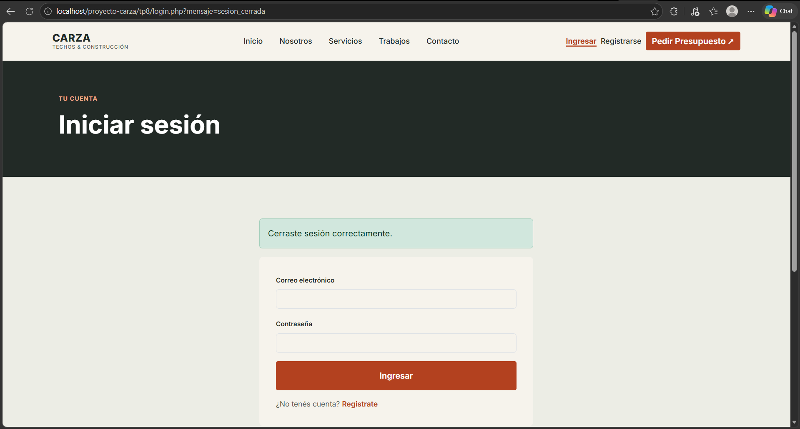

## TP N° 9 – Comunicación asincrónica y APIs (AJAX & JSON)

### Endpoints (`tp9/api/`)

| Endpoint | Método | Qué hace | Códigos HTTP |
| --- | --- | --- | --- |
| `buscar_trabajos.php?q=&categoria=` | GET | Busca trabajos publicados por palabra clave y categoría | 200, 400, 404, 405, 500 |
| `trabajo.php?id=` | GET | Devuelve el detalle de un trabajo | 200, 400, 404, 405, 500 |
| `consulta_estado.php` | POST (JSON) | Cambia el estado de una consulta (solo admin, con token CSRF) | 200, 400, 401, 403, 404, 405, 500 |

Todas las respuestas usan `Content-Type: application/json; charset=utf-8` y la forma `{ "status": "success|error", "message": "...", "data": ... }`. Usan PDO con consultas preparadas y `json_encode()`.

### Cliente (`tp9/js/app.js`)

- **Búsqueda en vivo** en `trabajos.php`: evento `input` (con espera de 300 ms), `change` de la categoría y `submit` con `preventDefault()`. Se cancela la petición anterior con `AbortController`.
- **Detalle en ventana modal:** al hacer clic en un trabajo se pide `api/trabajo.php` y se muestra sin salir de la página.
- **Cambio de estado sin recargar** en `admin/consultas.php`.
- Manejo de errores con `try/catch` (errores de red y códigos HTTP no exitosos) y mensajes en pantalla.
- El DOM se arma con `createElement` y `textContent`, no con `innerHTML`, para evitar XSS.
- Sin JavaScript el sitio sigue funcionando: la búsqueda y el cambio de estado usan los formularios del servidor.

### Capturas de pantalla

**Búsqueda en vivo (la URL cambia, la página no recarga)**
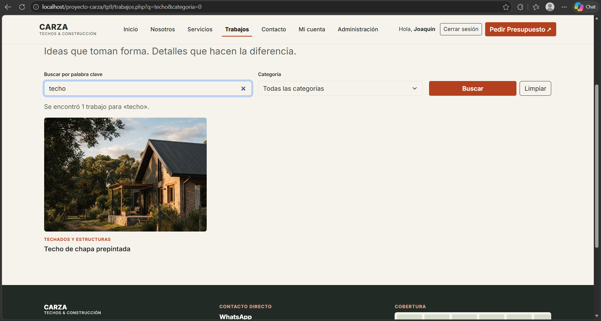

**Pestaña Network con la petición `buscar_trabajos.php` y su respuesta JSON**
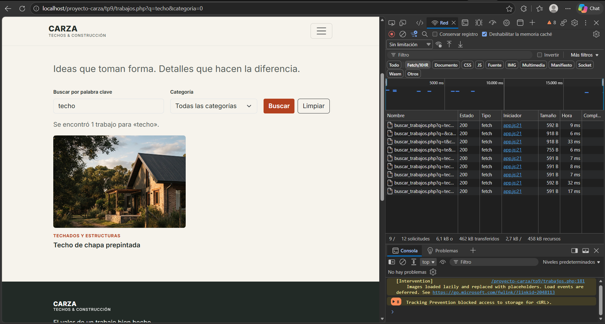

**Detalle de un trabajo en el modal**
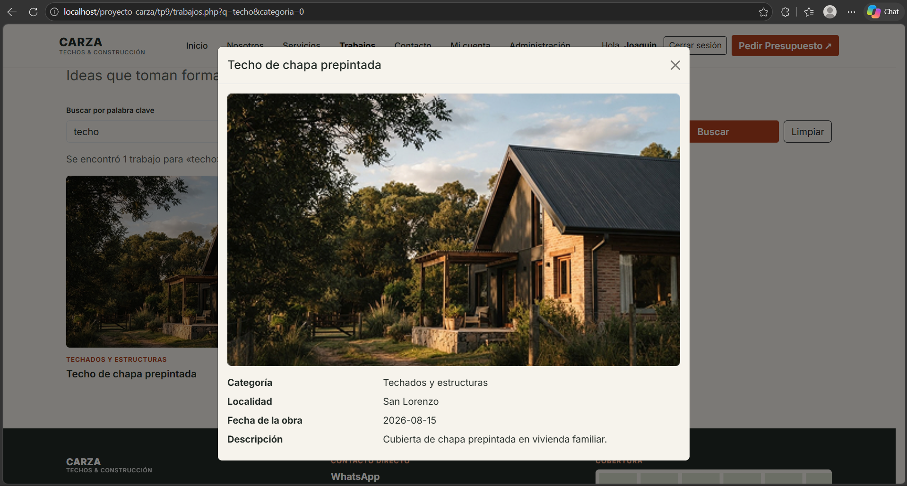

**Endpoint abierto en el navegador (JSON)**
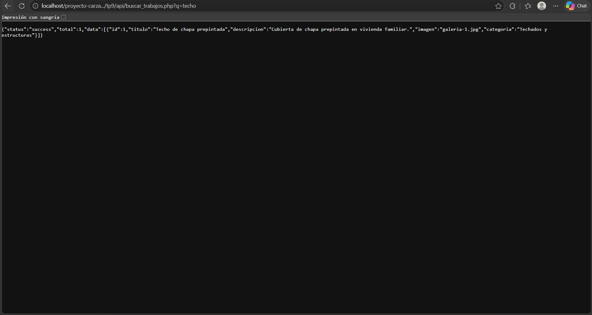

**Respuesta de error 404 / 400**
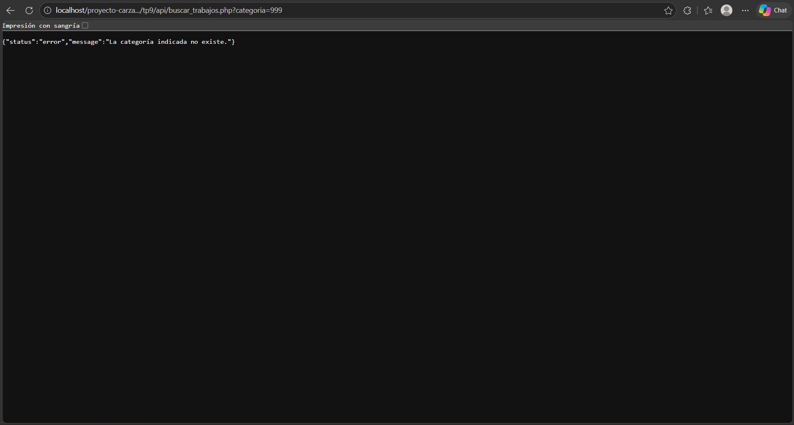

**Cambio de estado en el panel con mensaje de éxito**
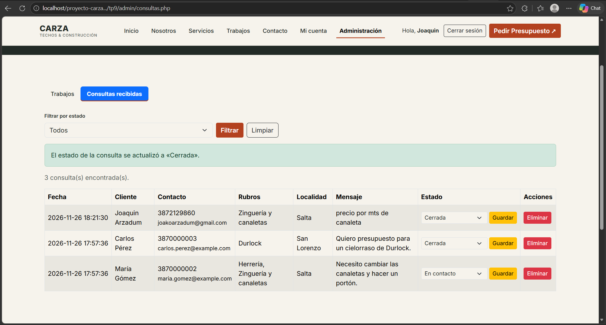

## TP N° 10 – Refactorización a MVC e implementación con framework

### Parte A – MVC nativo (PHP puro): [`tp10/mvc-nativo/`](tp10/mvc-nativo/)

Se refactorizaron los módulos de **catálogo de trabajos** y **autenticación** (registro, login, logout y cuenta) a una arquitectura MVC.

```
mvc-nativo/
├── public/               # única carpeta pública: index.php (controlador frontal), .htaccess, css, img
└── app/
    ├── Core/             # Router, Database (PDO), View, Sesion, Env, Controller base
    ├── Models/           # Trabajo, Categoria, Usuario  -> solo consultas SQL con PDO preparado
    ├── Controllers/      # Home, Trabajo, Auth, Cuenta -> reciben la solicitud, validan y eligen la vista
    ├── Views/            # plantillas HTML (layout + vistas), sin SQL
    └── routes.php        # tabla de rutas
```

| Capa | Responsabilidad | Ejemplo |
| --- | --- | --- |
| **Modelo** | Acceso a datos (PDO + consultas preparadas) | `Usuario::porEmail()`, `Trabajo::publicados()` |
| **Controlador** | Lee la entrada, valida, llama al modelo, elige la vista | `AuthController::login()` |
| **Vista** | Solo marcado HTML; imprime con `e()` (`htmlspecialchars`) | `Views/trabajos/index.php` |

Mantiene las medidas de seguridad de los TPs anteriores: bcrypt, `session_regenerate_id(true)`, cookie de sesión segura, token CSRF, validación en servidor y protección contra XSS e inyección SQL.

### Parte B – Módulo en Laravel: [`tp10/laravel-carza/`](tp10/laravel-carza/)

Módulo independiente de **reportes de consultas** sobre la misma base `carza_db`:

| Componente de Laravel | Archivo |
| --- | --- |
| **Routing** | `routes/web.php` → `/reportes` y `/api/reportes/consultas` |
| **Controlador** | `app/Http/Controllers/ReporteController.php` |
| **Modelos (Eloquent)** | `app/Models/Consulta.php`, `EstadoConsulta.php`, `Categoria.php` (relaciones `belongsTo`, `hasMany` y `belongsToMany`) |
| **Vista (Blade)** | `resources/views/reportes/index.blade.php` con el layout `layouts/app.blade.php` |
| **API REST (JSON)** | `GET /api/reportes/consultas?estado=` con códigos 200, 400 y 404 |

### Capturas de pantalla

**Estructura de carpetas MVC**
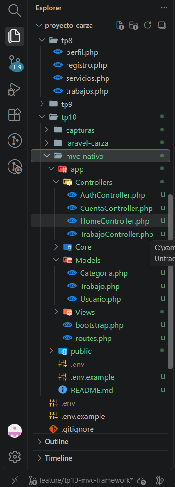

**Catálogo en la versión MVC nativa**
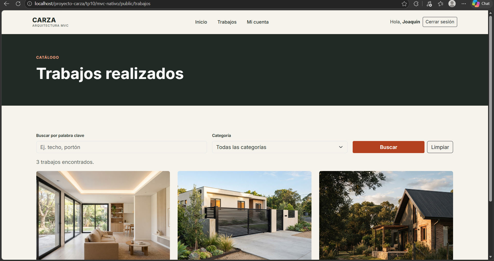

**Login en la versión MVC nativa**
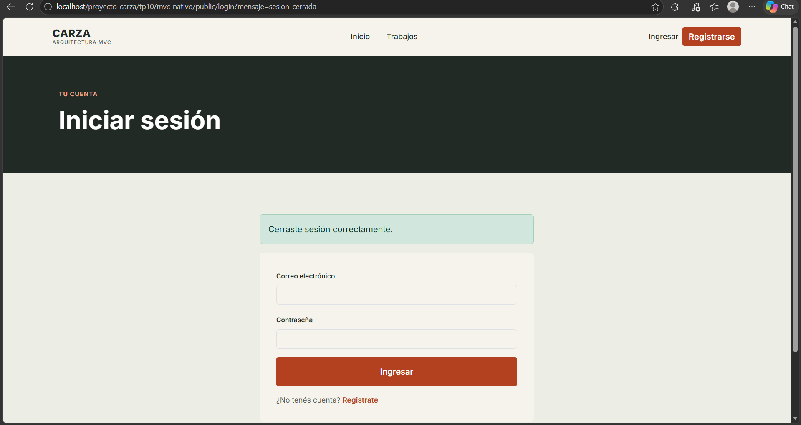

**Modelo con las consultas SQL separadas**
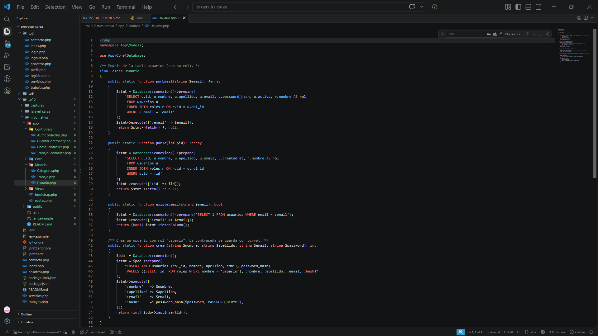

**Rutas de Laravel (`php artisan route:list`)**
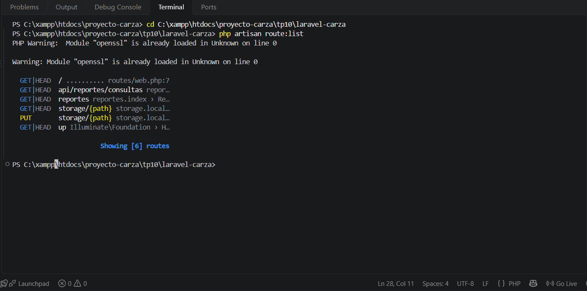

**Reporte con Blade**
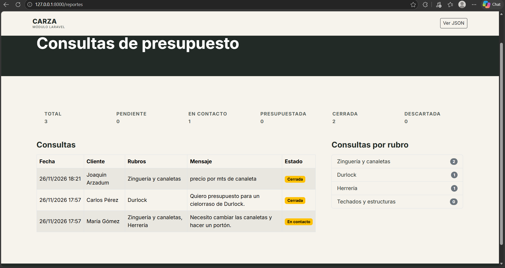

**API JSON de Laravel**
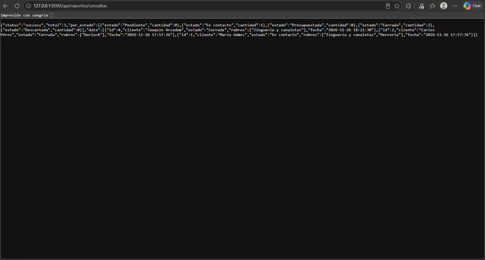

## Autor

Arzadum, Joaquin Jairo – Programación Web.
