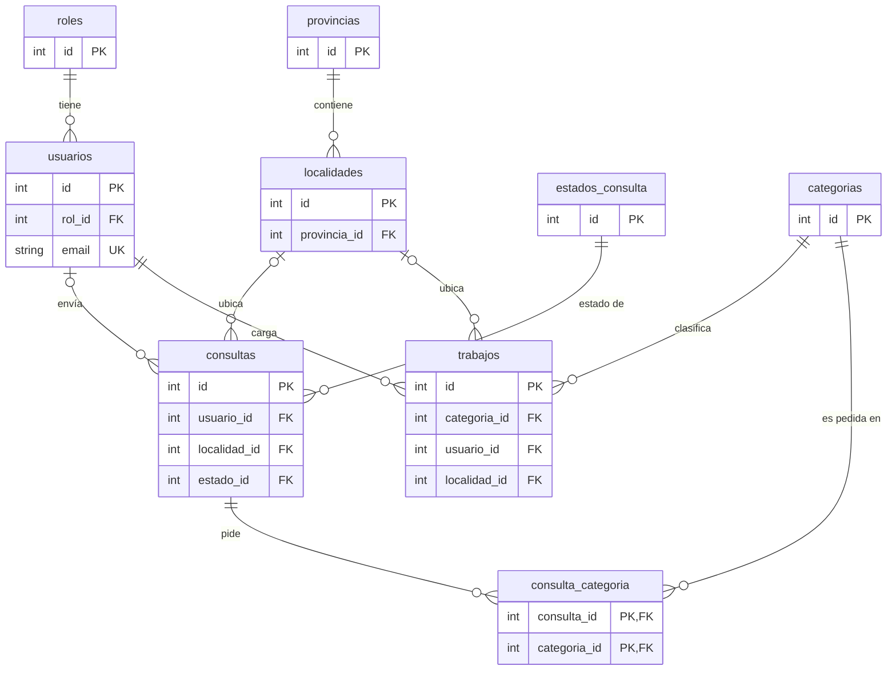

# TP N° 6 – Normalización y esquema relacional (CARZA)

Proyecto: sitio web de **CARZA**, emprendimiento familiar de techos, zinguería, Durlock y herrería. El sitio recibe consultas de presupuesto y muestra una galería de trabajos realizados.

## Parte 1 – Normalización

### 1. Tabla principal sin normalizar

Un pedido de presupuesto tal como llegaría del formulario de contacto, guardado en una sola tabla:

| id_consulta | cliente | teléfonos | email | servicios_pedidos | localidad | provincia | estado | descripcion_estado | fecha |
| --- | --- | --- | --- | --- | --- | --- | --- | --- | --- |
| 1 | María Gómez | 3870000002, 3870000010 | maria.gomez@example.com | Zinguería y canaletas, Herrería | Salta | Salta | Pendiente | Aún sin contactar | 2026-11-20 |
| 2 | Carlos Pérez | 3870000003 | carlos.perez@example.com | Durlock | San Lorenzo | Salta | Pendiente | Aún sin contactar | 2026-11-21 |

Problemas que se observan:

- **Campos multivalorados:** `teléfonos` y `servicios_pedidos` guardan varios valores en una sola celda.
- **Redundancia:** "Salta" (provincia) y "Aún sin contactar" (descripción del estado) se repiten en cada fila.
- **Anomalías:** si se cambia el texto de un estado hay que modificar muchas filas, y no se puede registrar un servicio o una provincia sin que exista una consulta.

### 2. Proceso de normalización

#### Primera Forma Normal (1FN): valores atómicos

Se eliminan los grupos repetitivos: cada celda tiene un único valor. Se genera una fila por cada combinación consulta–servicio (y se mantiene un solo teléfono de contacto por consulta; los teléfonos adicionales se descartan del alcance del sistema).

Clave primaria compuesta: **(id_consulta, servicio)**

| id_consulta | servicio | cliente | telefono | email | localidad | provincia | estado | descripcion_estado | fecha |
| --- | --- | --- | --- | --- | --- | --- | --- | --- | --- |
| 1 | Zinguería y canaletas | María Gómez | 3870000002 | maria.gomez@example.com | Salta | Salta | Pendiente | Aún sin contactar | 2026-11-20 |
| 1 | Herrería | María Gómez | 3870000002 | maria.gomez@example.com | Salta | Salta | Pendiente | Aún sin contactar | 2026-11-20 |
| 2 | Durlock | Carlos Pérez | 3870000003 | carlos.perez@example.com | San Lorenzo | Salta | Pendiente | Aún sin contactar | 2026-11-21 |

#### Segunda Forma Normal (2FN): sin dependencias parciales

Con la clave compuesta **(id_consulta, servicio)**, casi todos los atributos dependen **solo de `id_consulta`** (cliente, teléfono, email, localidad, provincia, estado, descripción y fecha). Es una dependencia parcial, así que se divide en dos tablas:

**consultas** – PK: `id_consulta`

| id_consulta | cliente | telefono | email | localidad | provincia | estado | descripcion_estado | fecha |
| --- | --- | --- | --- | --- | --- | --- | --- | --- |

**consulta_servicio** – PK compuesta: `(id_consulta, servicio)` (tabla N:M)

| id_consulta | servicio |
| --- | --- |

Además, el nombre del servicio se repite como texto: se extrae a una tabla `categorias` y la relación pasa a usar `categoria_id`.

#### Tercera Forma Normal (3FN): sin dependencias transitivas

En `consultas` hay atributos que dependen de otros atributos que no son la clave:

- `provincia` depende de `localidad` (localidad → provincia).
- `descripcion_estado` depende de `estado` (estado → descripción).

Se extraen a sus propias tablas:

- `provincias` y `localidades` (la localidad referencia a su provincia).
- `estados_consulta`.

Por la misma lógica, el rol de los usuarios va en una tabla `roles`, y los trabajos de la galería referencian a `categorias`, `usuarios` y `localidades` en lugar de repetir sus textos.

> **Decisión de diseño:** `consultas` conserva `nombre`, `telefono` y `email`, porque la consulta la puede enviar un visitante que no tiene cuenta. Son datos propios de esa consulta (lo que la persona escribió en el formulario). Cuando la persona sí está registrada, `usuario_id` la vincula con su cuenta.

### 3. Listado de tablas resultante

| Tabla | PK | FK | Descripción |
| --- | --- | --- | --- |
| `roles` | `id` | – | Roles de usuario (admin, editor, cliente) |
| `categorias` | `id` | – | Rubros: zinguería, techados, Durlock, herrería |
| `estados_consulta` | `id` | – | Estados de una consulta |
| `provincias` | `id` | – | Provincias |
| `localidades` | `id` | `provincia_id` → `provincias.id` | Localidades de cada provincia |
| `usuarios` | `id` | `rol_id` → `roles.id` | Cuentas con email y contraseña (hash) |
| `consultas` | `id` | `usuario_id` → `usuarios.id` (opcional), `localidad_id` → `localidades.id` (opcional), `estado_id` → `estados_consulta.id` | Pedidos de presupuesto |
| `trabajos` | `id` | `categoria_id` → `categorias.id`, `usuario_id` → `usuarios.id`, `localidad_id` → `localidades.id` (opcional) | Trabajos de la galería |
| `consulta_categoria` | `(consulta_id, categoria_id)` | `consulta_id` → `consultas.id`, `categoria_id` → `categorias.id` | Relación N:M entre consultas y rubros |

### Diagrama entidad-relación

## Parte 2 y 3

- [`schema.sql`](schema.sql): creación de la base `carza_db`, tablas, claves foráneas, campos de auditoría e índices (`idx_consultas_email`, `idx_consultas_estado_fecha`, `idx_trabajos_categoria_publicado`).
- [`consultas.sql`](consultas.sql): inserciones, lecturas con `WHERE`, `ORDER BY` e `INNER JOIN`, `UPDATE` y `DELETE`.
